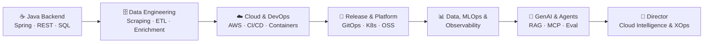

<!-- Header -->

  

  

  
  
  
  

---

### About

I'm a hands-on engineering leader who connects the whole stack: **application → API → data → cloud → platform → observability → AI**. I started as a Java backend engineer and have since built data pipelines, cloud platforms, release systems, telemetry pipelines and, most recently, agentic AI platforms that run in production.

Today I lead **Cloud Intelligence & XOps**: setting architecture and platform strategy, building reusable frameworks and accelerators, and growing engineers who can work across cloud, data and AI.

- 🧠 **Now:** agent platforms, MCP and A2A tooling, RAG, LLM evaluation and AI observability
- 🏗️ **Always:** Kubernetes, Terraform/OpenTofu, GitOps and self-service infrastructure
- 🔭 **Specialty:** OpenTelemetry pipelines and cost-aware observability, including for AI systems
- 🤝 **Open source:** release engineering for Seagate CORTX; contributor to the OpenTelemetry Collector

---

### What I build

<table>
  <tr>
    <td width="50%" valign="top">
      <h4>🤖 Agentic &amp; Generative AI</h4>
      Multi-agent workflows with LangGraph, LangChain and AWS Strands. MCP and A2A tool integration, RAG over enterprise knowledge, conversational analytics over Snowflake, Databricks and data lakes, plus memory, session and caching layers, prompt catalogs and evaluation pipelines.
    </td>
    <td width="50%" valign="top">
      <h4>☁️ Cloud &amp; Platform Engineering</h4>
      Production platforms on AWS and Azure: EKS, AKS and ECS, serverless, HA/DR. Self-service Terraform/OpenTofu modules, GitOps with Argo CD and Helm, secrets with Vault and External Secrets, and CI/CD platforms that teams adopt without being told to.
    </td>
  </tr>
  <tr>
    <td width="50%" valign="top">
      <h4>🔭 Observability &amp; XOps</h4>
      OpenTelemetry Collector pipelines, custom telemetry connectors, service discovery, and Grafana, Prometheus and Datadog stacks. Telemetry designed with cost in mind. AI observability with Langfuse and LangSmith, plus AI-assisted troubleshooting through MCP.
    </td>
    <td width="50%" valign="top">
      <h4>🗄️ Data &amp; MLOps</h4>
      Airflow, PySpark, Snowflake, Databricks and Delta Lake pipelines. Metadata, lineage and pipeline monitoring across platforms. SageMaker model pipelines, dataset management and continuous model validation.
    </td>
  </tr>
</table>

---

### Career arc

I've done this across **automotive, media & entertainment, storage, security & communications, retail, nonprofit and enterprise data** environments, nearly always on production systems rather than proofs of concept.

<b>Selected work</b>

 

- **AI platform observability (automotive):** a cognitive-agent assistant that combines live telemetry via Datadog MCP, Azure AI Search and engineering knowledge to speed up operational troubleshooting.
- **Enterprise RAG and conversational AI:** LangGraph assistants over Confluence, data dictionaries and architecture docs, with tool use, memory and versioned prompt catalogs in Langfuse.
- **Observability framework:** custom OTel connectors, service discovery and automated telemetry collection covering cloud resources, applications and vehicle telemetry, streamed into Grafana with cost controls.
- **Data platform metadata and lineage (media):** lineage across Snowflake, Airflow and Databricks built from query history and Delta Lake metadata, plus refresh and data-loss monitoring.
- **Serverless knowledge graph:** AWS AppSync, Amazon Neptune and ElastiCache/Valkey.
- **Release engineering for Seagate CORTX:** Jenkins shared libraries, GitOps, Kubernetes deployment testing and automated provisioning pipelines for an open-source object store.
- **Nonprofit cloud platform:** AWS infrastructure built from scratch, blue-green deploys and automated testing. Releases went from **weekly to daily**.

---

### Open source

| Project | Contribution |
|---|---|
| [**Seagate CORTX**](https://github.com/Seagate/cortx) | [70+ merged PRs](https://github.com/pulls?q=is%3Apr+author%3Agowchin+org%3ASeagate+is%3Amerged) to release engineering (`cortx-re`), `cortx-s3server` and `cortx-prvsnr`: CI/CD, mini-provisioner automation, multi-node deployment, stable-branch promotion |
| [**OpenTelemetry Collector Contrib**](https://github.com/open-telemetry/opentelemetry-collector-contrib) | Connector documentation: statefulness guidance for the Datadog ([#51624](https://github.com/open-telemetry/opentelemetry-collector-contrib/pull/51624), merged), span metrics, service graph and Grafana Cloud connectors |
| [**sandboxd**](https://github.com/tastyeffectco/sandboxd) | Reliability fixes for sandbox lifecycle and telemetry ([#121](https://github.com/tastyeffectco/sandboxd/pull/121), [#123](https://github.com/tastyeffectco/sandboxd/pull/123)) |

---

### Toolbox

**Languages & app frameworks**
 

**Cloud, containers & IaC**
 

 

**CI/CD & release**
 

**Observability**
 

**Data & MLOps**
 

 

**AI & agents**
 

---

### How I work

> **Build platforms rather than tickets.** Ship reusable modules, golden paths and accelerators that other teams can pick up and use themselves.
>
> **Production or it didn't happen.** Every system gets CI/CD, security guardrails, telemetry and a rollback plan before it's called done.
>
> **Observe everything, pay for what matters.** Telemetry should answer questions, not just pile up storage costs.
>
> **AI is a platform concern.** Agents need the same evaluation, observability, cost control and governance as any other production workload.

---

  

  

